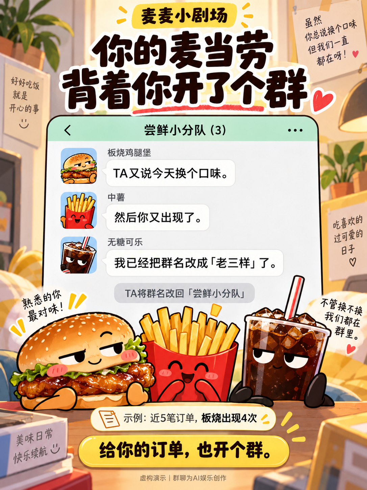

# 麦麦小剧场

**你的麦当劳，背着你开了个群。**

让近期订单里的汉堡、薯条、饮料成为群聊角色，围绕一个真实点单事实演一场小剧场。生成分享图，看看朋友常点的那几位又会聊些什么。



## 现在就能玩

**只体验：** 下载完整项目，双击 `app.html`。不用安装依赖，可以切换四种演示、自选餐品、导入脱敏订单或故事文件、换台词、下载 PNG 和复制分享文案。所有默认样本均明确标注“虚构演示”。

**用自己的订单：** 本机安装 Node.js 22 或更新版本后，在项目目录运行：

```sh
npm start
```

打开程序显示的本机地址 `http://127.0.0.1:4173/?mode=connect`，把自己的麦当劳 MCP Token 填到 **连接麦当劳** 的密码框，点击 **读取我的订单**。

Token 仅从页面传到本机服务，再用于当次官方 MCP 请求；提交后页面清空输入，不存入浏览器存储、日志或项目文件。单文件 `app.html` 的连接入口会提示启动本机服务。读取失败时保留上一张卡，并明确告知失败。

麦当劳 Token 申请与客户端接入见 [官方 MCP 使用指南](https://github.com/M-China/mcd-mcp-server)。本机服务固定连接 `https://mcp.mcd.cn`，只读近期订单，不创建或支付订单。

## 装成 Skill

将包含 `SKILL.md` 的整个项目目录，按你使用的 AI 客户端的本地技能导入方式导入；保留 `scripts/`、`src/`、`web/` 的相对位置。在该客户端连接官方麦当劳 MCP 后，可以这样说：

> 用我的近期已完成订单，生成麦麦小剧场。挑一个有依据的反差，让餐品自己聊起来，给我分享图和文案。

Skill 沿用当前 AI 客户端创作台词。附带程序提供本地统计、基础剧本和图片排版，不需要额外购买图像或文本模型 API。

目标用户是喜欢分享日常点单、希望给常点餐品做一个有趣纪念的麦当劳用户，以及想体验真实 MCP 内容创作的开发者。

## 四场不一样的戏

| 剧情 | 可核验的来源 |
| --- | --- |
| 常驻演员 | 某款餐品在本次样本中反复出现 |
| 饮料 C 位 | 某款饮料出现的订单数高于每款非饮料餐品 |
| 客串大会 | 多款不同餐品在样本中轮流出场 |
| 固定搭档 | 两款餐品在样本中总是同单出现 |

剧情选择由事实决定。换台词保留证据；“固定搭档”描述食品关系，不推断用餐人数。图片包含样本范围、事实依据和娱乐创作标记。

## 可复现命令

```sh
# 虚构演示：生成事实、故事及可直接打开的独立页面
node scripts/generate.mjs --demo --output generated

# 真实只读采集：先在本机设置 MCD_MCP_TOKEN 环境变量
node scripts/collect.mjs --output generated/orders.sanitized.json

# 文件导入默认标为“导入内容”，不把文件的自称来源当独立验证
node scripts/generate.mjs --input generated/orders.sanitized.json --output generated/story

# 带指定故事的本机分享页
node scripts/serve.mjs --story generated/story/story.json

# 重新生成无需服务器的 app.html
npm run build

# 本地协议、统计、去敏和本机连接测试
npm test
```

生成文件保存在被忽略的 `generated/`；`examples/` 只有虚构数据。脚本接受标准脱敏订单，不直接把包含个人信息的官方响应放进分享页。原始响应导入及参数选项见 `node scripts/collect.mjs --help`。

## 首版验证范围

已按官方公开文档实现 MCP Streamable HTTP 握手、工具发现、订单取数及字段适配；50 项本地测试通过，覆盖 JSON/SSE、会话、错误分类、已完成状态筛选、套餐展开与同单去重。已在实际浏览器检查桌面、390 px 手机页面及 PNG 导出；演示图片位于 `examples/share-demo.png`。每次版本更新后应重新检查分享图。

**2026 年 10 月 11 日，已由用户在本机输入自己的 Token，完成真实账号读取、故事生成和 PNG 下载。** 页面显示了实际订单来源、样本范围与餐品依据，并排除了完成状态未确认的记录。该验证覆盖最小使用流程；协议错误、套餐展开等边界另由本地合成测试覆盖，未逐项用真实账号重现。

项目仓库：https://github.com/danielliao/mcd-mini-theater 。公开仓库与作品包仅含虚构示例，不包含本次真实订单图片、原始响应或 Token。报名是否成功以官方报名 Issue 的系统回复为准。

## 参赛材料

已包含 `README.md`、官方原文 `CONTEST_DECLARATION.md`、`MCP_INTEGRATION.md`、仅含环境变量占位符的 `mcp-config.example.json`、Skill 与可运行源代码。另附 `SUBMISSION.md` 作为公开项目地址确认后使用的报名文案草稿。

作品不附 `workbuddy.md`，因为当前开发没有真实使用 WorkBuddy，不申报该专项开发条件。报名时间和资格以 [官方活动规则](https://github.com/M-China/mcd-developer-innovation-challenge/blob/main/activityGuidelines.md) 为准。

原始代码采用 MIT 许可。餐品名及第三方材料保留其权利；项目为非官方创意作品。MCP 服务、价格及供应以官方渠道为准。
